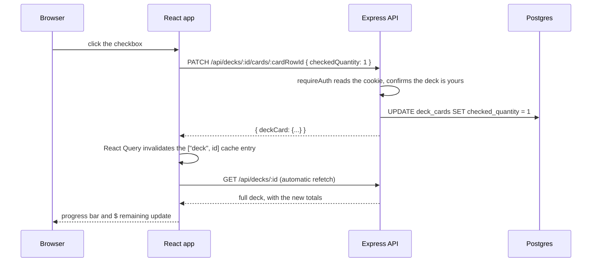

# How this app works

A plain-language walkthrough of the codebase: what each part does, how they fit together,
and where to look when you need to change something. Pairs with the inline comments in the
source files themselves — this doc gives you the map, the comments give you the detail once
you're in a file.

## What the app does

You paste or link a Magic: The Gathering decklist (from a text export, or a Moxfield/Archidekt/
MTGGoldfish deck page), the app matches every card against real Scryfall data (prices, images,
legal printings), and then gives you a checklist: tick off cards as you physically collect
them, see your total cost and how much is left to buy, and swap any card to its cheapest known
printing with one click.

## Tech stack

| Layer | Choice | Why it matters here |
|---|---|---|
| Client | React + Vite + TypeScript, Tailwind for styling | Fast dev server, no build config to maintain |
| Server | Express + TypeScript | Small, unopinionated — the whole API is ~10 files |
| Database | PostgreSQL, via Drizzle ORM | Drizzle keeps schema-as-code and generates migrations from it |
| Server state (client) | TanStack Query (React Query) | No manual loading/error state or cache invalidation code |
| Card data | Scryfall's public API | The single source of truth for card names, prices, images, legality |

## The three big ideas

Everything in this app is really just three things layered on top of each other:

1. **A card cache.** Scryfall has every card, but hitting it live for every page load would be
   slow and would blow through its rate limit. So there's a local `cards` table that mirrors
   whatever printings this app has ever looked up, refreshed automatically once a day.
2. **A deck is a list of (card, quantity, checked-off count) rows.** That's it — no separate
   "checklist" concept. `deck_cards.checkedQuantity` going from 0 up to `quantity` *is* the
   checklist.
3. **Import is "text or a link in, a list of matched cards out."** Three different input shapes
   (pasted text in four dialects, or a live fetch from three deck sites) all funnel down to the
   same shape before anything gets shown to the user or saved.

## Request flow, end to end

Here's what actually happens when you check off a card in the deck editor:



Every mutation in the app follows this same shape: a small PATCH/POST/DELETE, then the client
just re-fetches instead of trying to patch its local cache by hand. It's a few extra network
calls in exchange for never having a bug where the UI and the server disagree about state.

## Directory map

```
server/src/
  index.ts            starts the HTTP server + background jobs
  app.ts              builds the Express app: middleware, routes, error handler
  config/env.ts       validates environment variables at startup
  db/
    schema.ts         the database tables (Drizzle) — start here to understand the data model
    pool.ts           the shared Postgres connection
    migrations/       generated by `npm run db:generate`, applied by `npm run db:migrate`
  routes/             one file per API area — just wires URLs to controller functions
  controllers/        request handling: validate input, call services, shape the response
  services/
    auth.ts           password hashing + JWT session tokens
    scryfall/          the Scryfall API client and the local cache built on top of it
    decks/            deck-ownership checks, pricing math, cheapest-printing logic
    importParser/     turns pasted text or a deck link into a list of matched cards
  middleware/         auth gate + the global error handler
  jobs/               the nightly price-refresh cron job

client/src/
  main.tsx            mounts the app; sets up React Query, the router, and auth context
  App.tsx             the route table
  routes/             one component per page (Login, Register, Dashboard, DeckEditor, Import)
  components/         reusable pieces used by the pages (card search, printing picker, etc.)
  api/                typed fetch wrappers, one file per API area — mirrors server/routes/
  state/AuthContext.tsx   who's logged in, exposed via the useAuth() hook
```

If you're looking for where something happens: **routes** tell you *that* an endpoint exists,
**controllers** tell you *what* it does, and **services** hold the actual logic controllers
lean on. On the client, **routes/** are full pages and **components/** are the pieces inside them.

## The data model

Four tables, in `server/src/db/schema.ts`:

- **`users`** — email (case-insensitive), password hash, display name.
- **`cards`** — the local Scryfall cache. One row per *specific printing* (Scryfall id), not
  per card name — "Lightning Bolt" from ten different sets is ten rows. `oracleId` is what
  links all of those printings together as "the same card."
- **`decks`** — belongs to a user. `status` is mostly vestigial: the dashboard actually
  computes "complete" live from the numbers below rather than trusting this column (see
  [Why "complete" is computed, not stored](#why-complete-is-computed-not-stored)).
- **`deck_cards`** — the actual decklist. Each row is a (deck, printing, board, foil)
  combination with a `quantity` and a `checkedQuantity`. Adding the same card twice merges
  into the existing row instead of duplicating it. `board` is one of `main` / `side` /
  `maybe` / `commander`.

## Authentication

Straightforward cookie-based sessions, no OAuth or third-party login:

1. Register/login hashes the password with bcrypt and signs a JWT (`{ sub: userId }`) with a
   15-minute expiry.
2. The JWT is set as an `httpOnly` cookie — JavaScript in the browser can't read it, which
   limits what a cross-site scripting bug could steal.
3. Every protected route runs `requireAuth` middleware first, which verifies the cookie and
   attaches `req.userId` for the controller to use.
4. Every controller that touches a deck calls `getOwnedDeck(id, userId)`, which returns
   nothing unless that deck belongs to that user — so there's no separate "can this user see
   this deck" check scattered around; it's baked into how you fetch the deck at all.

There's no "remember me" or refresh-token flow yet — after 15 minutes you simply log in again.

## The decklist import pipeline

This is the most involved part of the app, so it's worth walking through in detail. There are
two ways to get cards in: **pasting text**, or **pasting a link** to a deck on another site.
Both end up producing the same shape (`ImportPreview`, a list of matched/unresolved/skipped
lines) before anything is shown to the user.

### Pasting text

```
raw text
   │
   ▼
detectFormat()   →  which dialect is this? (plain / Arena / Moxfield / Archidekt)
   │
   ▼
parseLines()     →  split into "N copies of Card Name, on board X" lines,
   │                 using that dialect's header/foil conventions
   ▼
resolveCards()   →  look each name up against the local card cache (falling back
   │                 to a live Scryfall fuzzy-name search), attach suggestions
   ▼                 if nothing matched
ImportPreview
```

The four "dialects" (`server/src/services/importParser/detectFormat.ts`) are really just
different conventions for two things: how a card line is formatted (`4x Lightning Bolt` vs.
`4 Lightning Bolt (M10) 146`) and how sideboard/maybeboard/commander sections are marked
(a `[Sideboard]` bracket, a `Sideboard:` header, or a blank line for Arena).

### Pasting a link

Instead of text, you can paste a Moxfield, Archidekt, or MTGGoldfish deck URL
(`server/src/services/importParser/urlImport.ts`). This skips the text-parsing step entirely:

- **Moxfield and Archidekt** hand back each card's *exact* Scryfall id in their own API
  response, so those cards are looked up directly by id — no name-matching, no chance of
  picking the wrong printing.
- **MTGGoldfish** only exports card names as plain text, so its export gets converted into
  decklist text (with a `Sideboard:` header inserted, since MTGGoldfish just uses a blank line)
  and run through the *same* text pipeline as a paste.

One quirk worth knowing: Moxfield's API is behind bot-detection that fingerprints the TLS
client and blocks Node's default `fetch`, even with a full set of browser headers. The fix
(in `urlImport.ts`) is to make that one request with Node's lower-level `https` module and a
curated cipher list instead — that's what gets through.

Either way — text or link — only the `main` and `commander` boards actually get imported.
Sideboard and maybeboard cards (like Moxfield's "Considering" pile) are excluded, because
they're not part of what you're actually trying to collect.

### Confirming an import

Once you've reviewed the preview and hit confirm, `commitImport` (in `importsController.ts`)
deletes the deck's existing cards and inserts the new list, all inside one transaction — so a
failure partway through can't leave you with half your old decklist and half your new one.

## Pricing and "cheapest printing"

Every cached card carries Scryfall's price for that specific printing. Two things build on that:

- **Deck totals.** The dashboard and deck editor both sum `quantity × price` across the main
  board. On the dashboard this is computed as SQL (`server/src/services/decks/deckPricing.ts`);
  in the deck editor it's computed in the browser from the cards already loaded on the page.
- **"Use cheapest printing."** Every printing of a card shares an `oracleId`. Finding the
  cheapest one means: look at every cached printing with that oracle id, and if none of them
  have a price yet, ask Scryfall for every printing sorted by price. Swapping to it (or back
  to a specific printing you pick manually) merges into an existing row of the same
  printing/board/foil if there already is one, rather than creating a duplicate.

## Why "complete" is computed, not stored

A deck's `status` column defaults to `in_progress` and mostly just stays that way — the
dashboard instead computes completion live: `checkedTotal >= quantityTotal && quantityTotal > 0`.

This used to be a real bug worth knowing about: those totals arrive from Postgres as
*strings* (`SUM()` returns a string over the wire), and comparing two numeric strings the
naive way is wrong whenever they have different lengths — `"99" >= "100"` is `true` as a
string comparison, even though 99 is less than 100. That meant a 100-card Commander deck
would get stuck showing "complete" after you unchecked one card back down to 99. The fix was
just to convert both values to real numbers before comparing (see `decksController.ts`'s
`listDecks`) — but it's the kind of bug that only shows up at specific card counts, so it's
called out here and in the code.

## Background jobs

One cron job (`server/src/jobs/priceRefresh.ts`), running nightly at 03:00 server time: find
every cached card whose data is more than 24 hours old and re-fetch it from Scryfall in
batches of 75. This is what keeps displayed prices from drifting too far from reality without
ever calling Scryfall on the hot path of a normal page load.

## Client-side state

Two different kinds of state, handled two different ways:

- **Server data** (decks, cards, printings) goes through **React Query**. Every page's data
  fetching is a `useQuery`, every write is a `useMutation` that invalidates the relevant query
  on success. There's no Redux-style global store — the query cache *is* the store.
- **"Who's logged in"** lives in `state/AuthContext.tsx`, which is itself just a thin wrapper
  around one React Query entry (`["me"]`) — logging in or out just writes straight into that
  cache entry instead of triggering a separate refetch.

## Local setup

See the main [README](./README.md) for how to get a database, install dependencies, and run
both the client and server locally.
